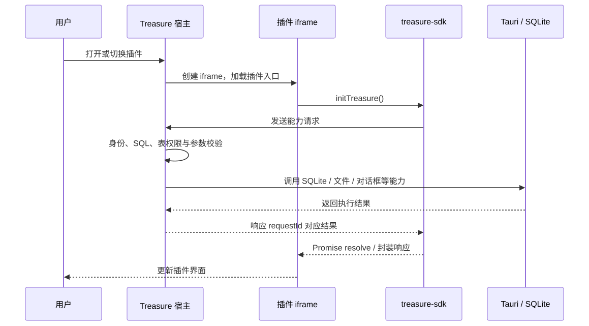

# Treasure SDK

[](https://www.npmjs.com/package/treasure-sdk)
[](LICENSE)
[](https://www.typescriptlang.org/)

**Treasure 插件 SDK** 是 [Treasure](https://github.com/Luzenrocy/treasure) 的官方插件开发工具包。它将插件与桌面宿主之间的交互收敛为稳定、类型化的 JavaScript API，并作为独立 npm 包发布：[`treasure-sdk`](https://www.npmjs.com/package/treasure-sdk)。

Treasure 在研发中将插件/工具与主程序解耦：一方面降低系统安装和运行时集成成本；另一方面将数据访问、安全校验和系统能力统一留在宿主侧控制。插件只需面向 SDK 编程，即可在受控边界内使用数据、文件、系统设置、系统对话框与原生菜单能力。开发服务可独立启动，但插件页面需由 Treasure 加载后才能使用这些能力。

## 目录

- [项目定位](#项目定位)
- [生态与职责边界](#生态与职责边界)
- [产品原型与功能逻辑](#产品原型与功能逻辑)
- [技术架构](#技术架构)
- [核心能力](#核心能力)
- [SDK 使用与插件研发入口](#sdk-使用与插件研发入口)
- [插件使用 SDK 的运行模型](#插件使用-sdk-的运行模型)
- [数据安全模型](#数据安全模型)
- [SDK 开发与扩展](#sdk-开发与扩展)
- [文档导航](#文档导航)
- [项目结构](#项目结构)
- [贡献与许可](#贡献与许可)

## 项目定位

Treasure 是一个以插件扩展为核心的桌面应用平台。`treasure-sdk` 不是业务插件本身，也不直接承担桌面系统能力；它是连接插件前端与 Treasure 宿主的 **客户端桥接层**。

它主要解决以下问题：

| 目标 | SDK 的解决方式 |
| --- | --- |
| 降低插件开发门槛 | 以 npm 包提供统一 API、TypeScript 类型、Vue 插件模板与 CLI 脚手架。 |
| 保持单一运行边界 | 插件页面始终由 Treasure 桌面宿主 iframe 承载；SDK 只通过宿主桥接执行能力。 |
| 保护平台与插件数据 | SQL 在宿主侧验证、重写与执行；插件只能访问自身命名空间的数据表和系统设置项。 |
| 保持系统能力的统一调用边界 | 插件只依赖 SDK 公开接口，不直接依赖 Treasure 内部模块或 Tauri API；Treasure 宿主负责将 SDK 请求映射到前端服务、Rust/Tauri 命令及相关 Tauri 插件。 |

## 生态与职责边界

| 项目 | 角色 | 职责 |
| --- | --- | --- |
| [Treasure](https://github.com/Luzenrocy/treasure) | 桌面宿主 | 插件安装与加载、iframe 容器、Tauri 系统能力、SQLite 执行、权限与菜单注册中心。 |
| [treasure-sdk](https://github.com/Luzenrocy/treasure-sdk) | 本项目 | 定义通信契约，封装插件 API，提供 CLI 和插件模板。 |
| [treasure-plugins](https://github.com/Luzenrocy/treasure-plugins) | 插件集合 | 承载面向用户的具体功能与工具实现。 |
| [Tauri v2](https://v2.tauri.app) | 桌面运行时 | 为 Treasure 宿主提供跨平台窗口、文件系统、系统对话框和 Rust 侧能力。 |



## 产品原型与功能逻辑

从用户视角，Treasure 提供一个可安装、可切换的工具工作台：用户在宿主中打开插件，插件以独立页面呈现业务界面；需要数据或系统能力时，SDK 将请求交由宿主执行并返回结构化结果。



### 插件生命周期

1. **宿主启动**：Treasure 注册桥接消息监听器和插件运行环境。
2. **插件加载**：用户打开插件后，宿主创建 iframe，加载插件包内的 `index.html`。
3. **SDK 初始化**：插件在 `app.mount()` 前调用 `initTreasure()`，SDK 使用宿主桥接实现。
4. **能力调用**：插件通过 `files`、`directories`、`storage`、`database` 等类型化模块发起异步请求。
5. **宿主执行**：宿主按能力注册表分发，解析 iframe 身份并执行授权、SQL AST 与 schema 校验。
6. **插件关闭**：标签页关闭时宿主注销该插件菜单，iframe 移除后通信自动断开。插件卸载则由插件中心执行迁移清理和包目录清理。

## 技术架构

SDK 由“公开 API、宿主桥接、开发工具”构成。



### 受控宿主桥接

在注册调试插件和安装包两种载体中，插件都运行在 Treasure 的 iframe 内。`ProductionBridge` 为每次调用分配 `requestId`，以 `postMessage` 将类型化 operation 提交到父窗口，并将匹配响应还原为 `Result<T>`。宿主不信任请求载荷中的插件身份，而是从 `MessageEvent.source` 对应的已注册 iframe 解析身份，并校验其来源。

插件项目的 `npm run dev` 只启动供 Treasure 注册调试插件的本地开发服务。插件页面必须由已安装的 Treasure，或通过 `npm run tauri -- dev` 启动的 Treasure 桌面应用加载；数据库、文件、设置等能力也由该应用提供。

## 核心能力

| 能力域 | SDK 入口 | 说明 |
| --- | --- | --- |
| SQL 数据 | `database.query / execute / transaction` | 参数化查询、写入和原子事务；Rust AST 校验表声明并重写命名空间。 |
| 文件管理 | `files`、`directories` | 用户选择产生文件/目录引用；数据为 `Uint8Array`，删除移入回收站。 |
| 私有存储 | `storage` | 仅使用经校验的相对键，绝不暴露绝对路径。 |
| 系统设置交互 | `settings` | 读取或更新当前插件在 Treasure 系统设置模块中的设置项。 |
| 菜单协作 | `menus` | 注册和注销宿主菜单。 |
| 日志与通知 | `logs`、`notifications` | 结构化日志与系统通知。 |

所有响应使用 `Result<T>`：`ok: true` 包含 value，`ok: false` 包含结构化错误码。SDK 2.0 不保留旧 API 兼容层。

## SDK 使用与插件研发入口

`treasure-sdk` 的使用说明、插件研发流程与 SDK 自身开发是三类不同内容，分别由对应文档维护：

| 目标 | 应阅读的文档 | 内容边界 |
| --- | --- | --- |
| 在既有插件工程中接入 SDK | [API 参考](docs/API-REFERENCE.md) | 安装、初始化、公开方法、类型、参数、返回值和兼容性。 |
| 创建、调试和发布业务插件 | [插件研发指南](https://github.com/Luzenrocy/treasure-plugins/blob/main/docs/PLUGIN-DEVELOPMENT-GUIDE.md) | CLI 创建、manifest、注册调试插件、打包导入与发布。 |
| 修改 SDK 的公开接口、桥接实现、CLI 或模板 | [SDK 开发与扩展指南](docs/SDK-DEVELOPMENT-GUIDE.md) | 源码分层、能力扩展链路、CLI/模板变更、构建与兼容性检查。 |

CLI 使用 `npx treasure-sdk create <plugin-code>` 按需下载并执行，不要求全局安装。生成的插件项目会在 `package.json` 中声明 `treasure-sdk`，且 CLI 默认执行 `npm install`；安装细节和失败处理见插件研发指南。

## 插件使用 SDK 的运行模型

业务插件只有一个 SDK 运行模型：由 Treasure 桌面应用创建 iframe，`ProductionBridge` 在内部通过 `window.parent.postMessage` 向父窗口发送 operation，Treasure 再校验来源、识别插件并执行能力。Treasure 可以从两类来源加载插件页面：一类是导入并安装到应用数据目录的插件包，另一类是通过“注册调试插件”登记的本地开发服务地址。两类页面都进入同一套宿主桥接和能力边界；只有 `manifest.name` 相同的插件身份才会访问同一插件数据空间。

## 数据安全模型

数据访问的核心原则是：**插件发起意图，宿主决定是否执行**。SDK 不是权限最终裁决者，所有关键 SQL 规则都由宿主实施。


- 插件查询、写入和事务必须显式声明使用到的 `tables`。
- 宿主将裸表名重写为 `plugin_{pluginCode}_{table}`，实现插件间表空间隔离。
- 宿主拒绝插件访问平台核心表，并限制插件可执行的 SQL 操作类型；`DROP`、`ALTER`、`RENAME TABLE` 等危险 DDL 不允许通过常规数据通道。
- 事务中的每一条 SQL 均需单独校验与重写。
- 系统设置的读取和保存始终以 `pluginCode` 过滤，插件不能通过 SDK 指定其他插件的设置空间。
- 插件入口的 `treasure-plugin-code` 必须与 manifest 身份一致；宿主最终以消息来源对应的已注册 iframe 解析插件身份，请求与响应通过 `requestId` 关联。

> 文件操作由宿主 Tauri 文件能力执行。插件与宿主应将插件包视为受信任代码，并由宿主继续落实安装来源、路径范围和版本兼容性等策略；SDK 不替代宿主侧的文件权限治理。

## SDK 开发与扩展

本节面向维护 `treasure-sdk` 本身的开发者，而不是业务插件作者。SDK 的一项能力扩展通常需要同步调整公开类型与导出、宿主桥接、文档与模板；若新增桥接 operation，还需同步 Treasure 宿主能力注册表并保持同一协议版本。

详细的源码职责、接口扩展步骤、CLI/模板调整和发布前检查见 [SDK 开发与扩展指南](docs/SDK-DEVELOPMENT-GUIDE.md)。SDK 仓库的本地构建命令为：

```bash
npm install
npm run dev       # 监听构建 SDK
npm run build     # 产出 ESM、CJS、类型声明和 CLI
npm run typecheck
npm test
npm run docs:diagrams # Mermaid 源图生成 npm 可展示的 SVG
npm run pack:check
```

## 文档导航

README 说明 SDK 的定位、运行模型和工程组织；以下文档各自只承担一种职责：

| 文档 | 内容边界 |
| --- | --- |
| [桥接协议](docs/BRIDGE-PROTOCOL.md) | 请求/响应信封、类型化 operation、安全责任与版本兼容。 |
| [API 参考](docs/API-REFERENCE.md) | 公开方法、类型、参数、返回值和可选能力。 |
| [插件研发指南](https://github.com/Luzenrocy/treasure-plugins/blob/main/docs/PLUGIN-DEVELOPMENT-GUIDE.md) | 创建、manifest、调试、构建、发布和研发检查清单。 |
| [SDK 开发与扩展指南](docs/SDK-DEVELOPMENT-GUIDE.md) | SDK API、桥接实现、CLI 与模板的维护和扩展。 |
| [2.0 迁移指南](docs/MIGRATION-2.0.md) | 1.x 接口、路径模型和旧响应向 2.0 的迁移步骤。 |
| [三项目文档迭代记录](https://github.com/Luzenrocy/treasure-plugins/blob/main/docs/DOCUMENTATION-ITERATION-LOG.md) | 每轮修复方案、第三方审查结论、验证证据和源码遗留项。 |

## 项目结构

```text
treasure-sdk/
├── src/
│   ├── index.ts                # 公共 API 入口
│   ├── result.ts               # Result<T> 与错误码
│   ├── client.ts               # 类型化能力客户端
│   ├── bridge.ts               # 单例工厂与宿主桥接
│   ├── bridge-impl/
│   │   └── production.ts       # iframe + postMessage 实现
│   ├── files.ts                # 文件引用能力门面
│   ├── storage.ts              # 私有相对键存储门面
│   └── cli/                    # treasure-sdk create 脚手架
├── template/                   # Vue 插件项目模板与打包脚本
├── docs/
│   ├── BRIDGE-PROTOCOL.md       # 宿主与 SDK 的通信协议
│   ├── API-REFERENCE.md         # SDK 公开接口参考
│   ├── diagrams/                 # README Mermaid 源图及生成的 SVG
│   ├── MIGRATION-2.0.md          # 1.x 插件迁移到 2.0
│   └── SDK-DEVELOPMENT-GUIDE.md # SDK 自身维护与扩展指南
├── scripts/
│   └── generate-readme-diagrams.mjs # 同步 README 图与版本化图片链接
└── package.json
```

## 贡献与许可

欢迎通过 Issue 和 Pull Request 参与改进。提交涉及桥接协议时，请同时考虑类型定义、插件模板与宿主兼容性。

本项目采用 [Apache License 2.0](LICENSE) 许可。
